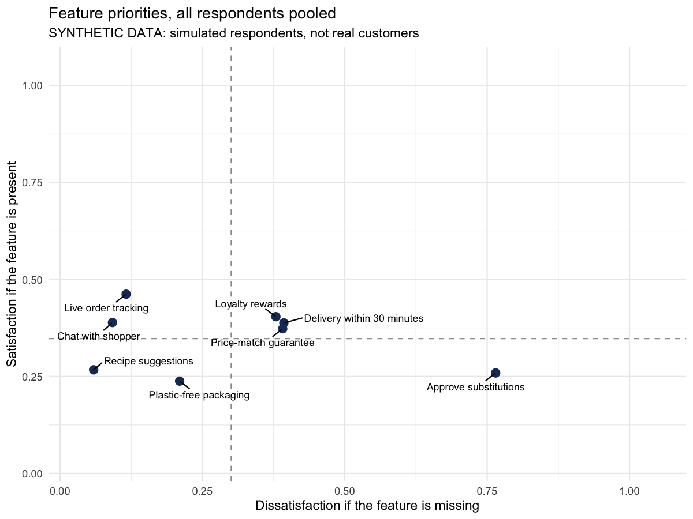
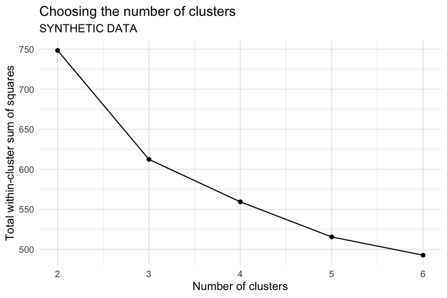
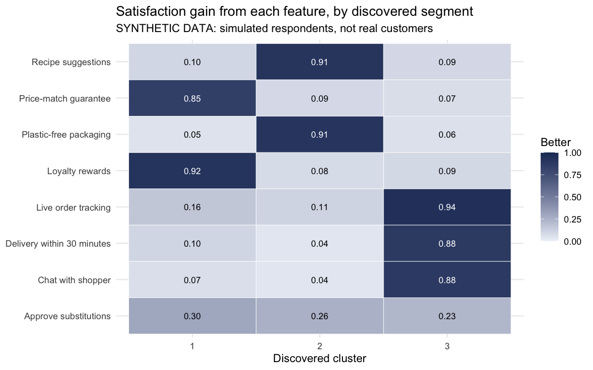
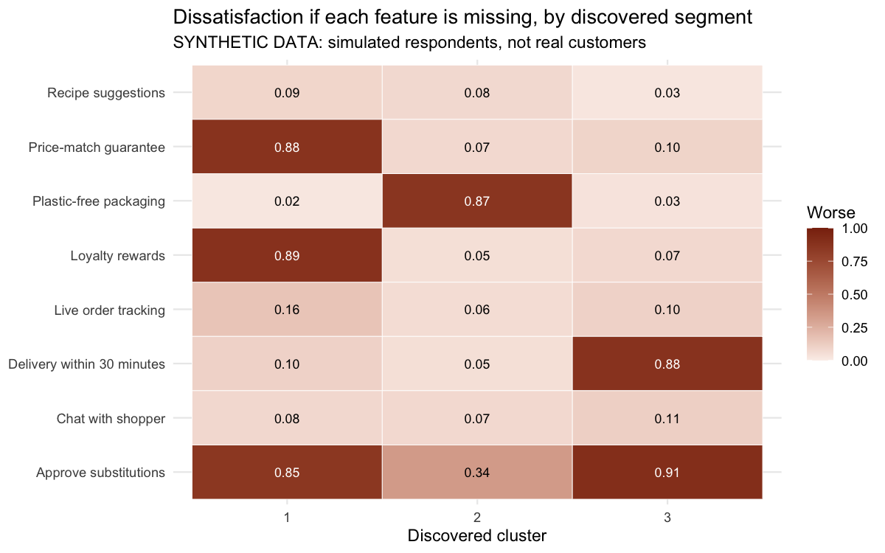

# Kano Pilot Study on Simulated Data: Grocery Delivery App Features

> **Every response in this project is synthetic. No real people were surveyed.** The results show that the analysis method works on data with a known structure. They say nothing about real customer preferences.

## Summary

This project is a small, fully reproducible demonstration of a Kano analysis, a method that sorts product features by how customers react to having them and to not having them. Eight features of a fictional grocery delivery app were each asked as a pair of questions. Four hundred synthetic respondents were generated from three planted customer segments. An analysis that never saw the segment labels grouped respondents by their Kano classifications and recovered the planted segments with an **adjusted Rand index of 0.919**, placing **389 of 400 respondents (97 percent)** in the correct group.

The full write-up is in [`kanomethods_exp_writeup.pdf`](kanomethods_exp_writeup.pdf), and a shorter plain-language version is in [`summary.md`](summary.md).

## What the project covers

1. **Survey design.** A paired-question Kano instrument for eight features ([`survey_instrument.md`](survey_instrument.md)).
2. **Simulation.** Synthetic respondents are generated from three planted segments with different feature preferences ([`R/01_simulate_responses.R`](R/01_simulate_responses.R)). The true segment of each respondent is saved in a separate file, so the analysis never sees it.
3. **Analysis.** Every answer pair is classified with the standard Kano evaluation table, features are summarized with Better and Worse scores, respondents are clustered with k-means, and the clusters are compared with the planted truth ([`R/02_analyze_kano.R`](R/02_analyze_kano.R)).

## Why simulate

Fielding a real Kano survey takes days or weeks. A simulation with a known structure lets the full pipeline be built and tested quickly. Because the segments are planted, the analysis can be scored on whether it recovers them, which is a check that real survey data cannot offer.

## Results

### 1. Pooled results hide the structure



When all respondents are pooled, most features fall in a middle band, and only approving substitutions stands out as a must-be feature (low satisfaction gain, high dissatisfaction if missing). Pooling hides the real pattern, which is that different groups want different things.

### 2. Choosing the number of clusters



Within-cluster variation falls sharply from two clusters to three and more gently afterward. The bend is moderate rather than sharp, and the true number of segments was known in advance, so with real data this choice would need further support.

### 3. What each discovered segment wants





Each cluster has a clear profile. Cluster 1 rewards anything that lowers the cost of an order, cluster 2 responds to plastic-free packaging and recipe suggestions, and cluster 3 values speed, tracking, and chat with the shopper.

### 4. Did the method recover the hidden segments?

| Planted segment | Cluster 1 | Cluster 2 | Cluster 3 |
| --- | --- | --- | --- |
| Budget-focused | 148 | 2 | 1 |
| Convenience-seeking | 4 | 1 | 158 |
| Sustainability-minded | 1 | 83 | 2 |

The adjusted Rand index is 0.919, and 389 of 400 respondents (97 percent) were placed in the cluster that matches their planted segment. This measures how clear the planted structure was, not how well the method would do on real customers.

## How to run

Requires R and the `ggplot2` package. The `ggrepel` package is optional and keeps chart labels from overlapping.

```r
install.packages(c("ggplot2", "ggrepel"))

# Run from the project folder (the one that contains R/, data/, and figures/)
source("R/01_simulate_responses.R")   # writes data/*.csv
source("R/02_analyze_kano.R")         # writes figures/*.png and data/*.csv
```

The random seed is fixed, so the results are identical on every run. If a script cannot find a file, check the working directory with `getwd()` and set it with `setwd()`.

## Repository structure

| Path | Purpose |
| --- | --- |
| `R/01_simulate_responses.R` | Generates the synthetic responses and the planted truth |
| `R/02_analyze_kano.R` | Classifies, summarizes, clusters, and plots |
| `survey_instrument.md` | The Kano questions and answer scale |
| `summary.md` | A short plain-language summary of the results |
| `kanomethods_exp_writeup.pdf` | The full write-up (PDF) |
| `paper/` | The LaTeX source of the write-up |
| `figures/` | Charts produced by script 2 |
| `data/` | CSV files produced by the scripts |

## Limits

- The segments, the feature preferences, and the size of each group were invented by the author, so recovering them shows only that the method works when the structure is clear.
- Real data is noisier, samples are smaller, and respondents may interpret the paired questions inconsistently.
- Statistical tests comparing the clusters are not offered as evidence, because the clusters were built from the same answers.
- The next step would be to field the same instrument to a sample of real customers.

## Author

Matthew Caulfield. This project is released under the MIT License.
