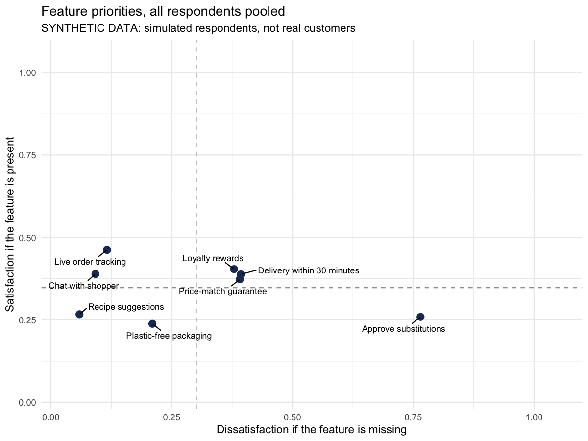
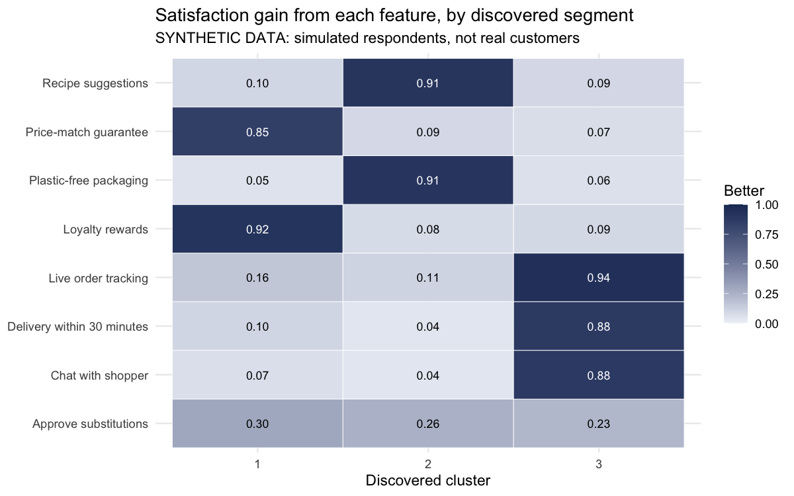
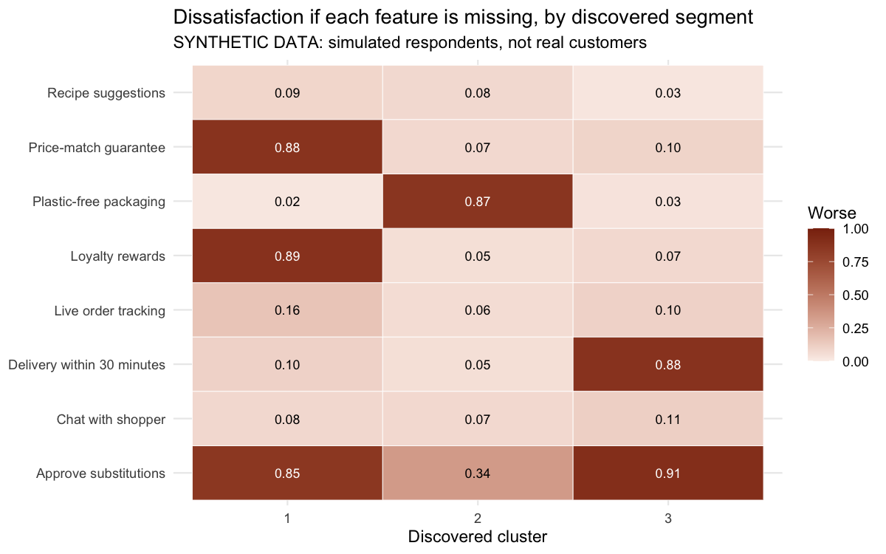

# Kano Pilot (Simulated Data): What a Grocery Delivery App Should Build First

**Every response in this study is synthetic. No real customers were surveyed. The findings below show how the method performs on data with a known structure and should not be read as evidence about real customer preferences.**

## Purpose

This project tests a complete Kano analysis workflow, from instrument design to segmentation, on simulated respondents. Because the customer segments were planted in advance, the analysis can be checked against a known answer before the same method is used on real people.

## Method

Eight features of a fictional grocery delivery app were each asked as a pair of questions: how the respondent would feel if the app had the feature, and how they would feel if it did not. Answer pairs were classified with the standard Kano evaluation table into Attractive, One-dimensional, Must-be, Indifferent, Reverse, or Questionable. For each feature, a satisfaction gain ("Better") and a dissatisfaction if missing ("Worse") score were calculated.

A total of 400 synthetic respondents were generated from three planted customer segments: budget-focused (151 respondents), convenience-seeking (163), and sustainability-minded (86). The planted labels were stored in a separate file. The analysis did not use them. It grouped respondents with k-means clustering on their Kano classifications, using three clusters, and then compared the clusters with the planted truth.

## What the pooled data shows

When all respondents are combined, most features fall in a middle band with moderate satisfaction gain (about 0.25 to 0.45) and low to moderate dissatisfaction if missing. Only one feature stands out. Approving substitutions has low satisfaction gain (about 0.26) but high dissatisfaction if missing (about 0.76), which is the signature of a must-be feature: customers expect it and notice only when it is absent. Pooling hides the more interesting pattern, which is that different groups want different things.

## What the segments show

The clustering found three groups of 153, 86, and 161 respondents, each with a clear profile.

- **Cluster 1 (budget-focused).** Loyalty rewards and the price-match guarantee are performance features: satisfaction gain is 0.92 and 0.85, and dissatisfaction if missing is 0.89 and 0.88. This group rewards anything that lowers the cost of an order.
- **Cluster 2 (sustainability-minded).** Plastic-free packaging is a performance feature (0.91 gain, 0.87 if missing). Recipe suggestions are a delighter: satisfaction gain is 0.91, but dissatisfaction if missing is only 0.08, so the feature pleases customers without being missed.
- **Cluster 3 (convenience-seeking).** Delivery within 30 minutes is a performance feature (0.88 and 0.88). Live order tracking and chat with the shopper are delighters (satisfaction gain of 0.94 and 0.88, with dissatisfaction if missing of 0.10 and 0.11).

Approving substitutions is a must-be for clusters 1 and 3 (dissatisfaction if missing of 0.85 and 0.91) and a minor concern for cluster 2 (0.34). Its satisfaction gain is low in every cluster, between 0.23 and 0.30, so a satisfaction chart alone would have led to ignoring it.

## Did the method recover the hidden structure

The clusters matched the planted segments closely. The adjusted Rand index was 0.919, where 1 means perfect agreement and 0 means no better than chance. Of the 400 respondents, 389 (97 percent) were placed in the cluster that corresponds to their planted segment.

| Planted segment | Cluster 1 | Cluster 2 | Cluster 3 |
| --- | --- | --- | --- |
| Budget-focused | 148 | 2 | 1 |
| Convenience-seeking | 4 | 1 | 158 |
| Sustainability-minded | 1 | 83 | 2 |

The number of clusters was chosen with an elbow chart. Within-cluster variation fell sharply from two clusters to three (from about 750 to about 610) and more gently afterward. The bend is moderate rather than sharp, and the author already knew the true number of segments. With real data, the choice of three would need further support, such as checking that the clusters are stable across repeated runs and that the groups make practical sense.

## What this would mean for a real client

If real respondents showed this pattern, the implications would be as follows. The must-be feature, substitution approval, should be protected first, because failing on it loses the two largest groups. Each group then has its own route to differentiation: price features for the budget group, packaging and recipes for the sustainability group, and speed and tracking for the convenience group. A single feature list for everyone would invest in features that most customers do not value. This is an illustration of how the findings would be read, not a recommendation for any actual company.

## Limits

The segments, preferences, and group sizes were invented by the author, so recovering them shows only that the method works when the structure is clear. Real data is noisier, samples are smaller, and respondents may interpret the paired questions inconsistently. Statistical tests comparing the clusters are not reported as evidence, because the clusters were built from the same answers and would differ by construction. The next step would be to field the same instrument to a sample of real customers.

## Files

All code, figures, and the full write-up are in this repository. Running the two scripts in the `R` folder in order reproduces every number and chart.
